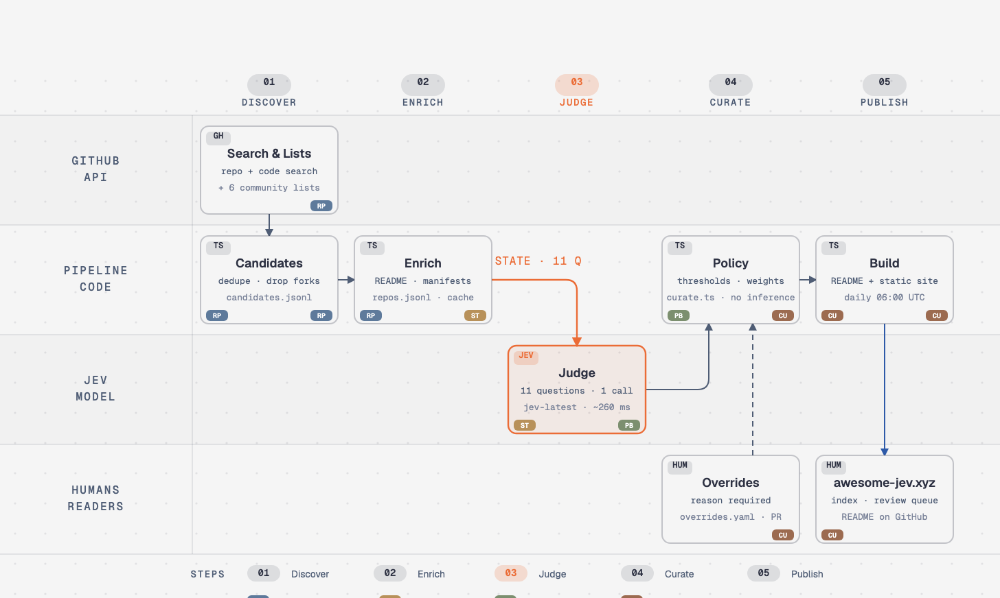

# Awesome Jev 

   

> Projects built on [Jev](https://typesafe.ai), TypeSafe AI's System One model. Curated by Jev itself.

Every repository here was collected from GitHub, then judged by Jev in a single call: is it genuinely about Jev, which category, which decision pattern, and how substantial, documented, and novel it is. Code applies the policy; nothing below was hand-picked. The full index with probabilities lives on the site, along with the [review queue](https://awesome-jev.xyz/review) of borderline cases.

This is an independent community project, not affiliated with TypeSafe AI. Jev and System One are TypeSafe AI product names.

## Contents

- [Official](#official)
- [SDKs and Clients](#sdks-and-clients)
- [Integrations](#integrations)
- [Agent and Developer Tooling](#agent-and-developer-tooling)
- [Applications](#applications)
- [Games, Robotics, and Simulation](#games-robotics-and-simulation)
- [Research, Evals, and Reimplementations](#research-evals-and-reimplementations)
- [Learning](#learning)
- [Other Lists](#other-lists)
- [Other](#other)
- [How This List Is Made](#how-this-list-is-made)

## Official

Maintained by TypeSafe AI.

- [system-one-adapter-python](https://github.com/typesafe-ai/system-one-adapter-python) - Drop-in TypeSafeClient replacement backed by LLM APIs.
- [typesafe-sdk-js](https://github.com/typesafe-ai/typesafe-sdk-js) - The official TypeScript/JavaScript library for the TypeSafe API.
- [WorkflowEvals](https://github.com/typesafe-ai/WorkflowEvals) - Evals.typesafe.ai workflow code published.
- [typesafe-sdk-python](https://github.com/typesafe-ai/typesafe-sdk-python) - The official Python library for the TypeSafe API.
- [skills](https://github.com/typesafe-ai/skills) - Agent skills for building with TypeSafe's System One API.

## SDKs and Clients

Language bindings, CLIs, and thin wrappers for the API.

- [jevi](https://github.com/bitomule/jevi) - Ask typed questions about a text and branch on the answer. A shell front end for TypeSafe's Jev.
- [jev-ultralightspeed](https://github.com/collapseindex/jev-ultralightspeed) - BRRRRRRRRRRRRRRRRRRRRRR.
- [solo_jev](https://github.com/0814wdwd/solo_jev) - Per-row semantic judgements over large relational tables on a decision model (Jev).
- [daf-jev](https://github.com/docxology/daf-jev) - Composable Python toolkit for TypeSafe's Jev (System One) decision API — question builders, confidence gates, evaluator, calibration, CLI, MCP server, agent skill.
- [ak-jev](https://github.com/ak--47/ak-jev) - Node.js bindings for TypeSafe's Jev — the System One model. Typed decisions, probabilities and confidence, with no text generation and no parsing.
- [ruby_decision_model](https://github.com/obie/ruby_decision_model) - Ruby client for decision models such as Typesafe Jev.
- [jevkit](https://github.com/ariel-frischer/jevkit) - Fast Rust CLI for TypeSafe Jev: typed decisions, offline linting before you pay.
- [laya](https://github.com/receptron/laya) - Run Laya, the open-source Jev-compatible System-1 decision model, from Node.js / TypeScript via ONNX Runtime.
- [AnyDecisionModel](https://github.com/mattt/AnyDecisionModel) - A Swift package for typed decisions from language models (probabilities, choices, and scores), with support for local MLX models and the TypeSafe Jev API.
- [decision-gate](https://github.com/zachlandes/decision-gate) - Rate and spend limits for code that calls Jev and other decision models.
- [jev-spec](https://github.com/nozomi-koborinai/jev-spec) - ⚡ Catch spec drift on every commit: check your code against your Markdown specs with TypeSafe AI's Jev model.
- [jev-tree](https://github.com/reachjalil/jev-tree) - Recursive Jev choice over a taxonomy. Select from more than 255 options without breaking TypeSafe Jev's choice cap.
- [jevkit](https://github.com/tegersdorfer-collab/jevkit) - Decision kernel for TypeSafe Jev (System One): typed questions, bands, state building, composition.
- [ts-jev-cost-calculator](https://github.com/StefanoITA/ts-jev-cost-calculator) - Unofficial CLI + Python estimator of tokens, cost and context limits for TypeSafe (System One / Jev) API requests. Not affiliated with TypeSafe.
- [jevclient](https://github.com/AboveColin/jevclient) - Async Python client for TypeSafe Jev. Typed questions in, probabilities and choices out, no prose to parse.

## Integrations

Jev wired into frameworks, gateways, platforms, and databases.

- [pg-jev](https://github.com/realZachi/pg-jev) - Ask your PostgreSQL tables questions in plain language. A PostgreSQL extension powered by TypeSafe's Jev.
- [LLM2Jev](https://github.com/Yinsongxu/LLM2Jev) - Turn local language models into Jev-style structured decision models. Get results from text and images with prefill alone—no token-by-token decoding required.
- [Jevstiller](https://github.com/tomerglick57/Jevstiller) - Distill a repeated Jev classification task into a local model, on the fly — same answers, your hardware.
- [jevrag](https://github.com/ajanm007/jevrag) - A pluggable decision substrate for RAG pipelines; explicit, calibrated state → Decision → confidence → action gates, with Jev as the first swappable backend.
- [duckdb-jev](https://github.com/prasanthj/duckdb-jev) - High-throughput, robust native DuckDB extension for batched and streaming TypeSafe/Jev classification, scoring, and semantic predicates from SQL.
- [jev4pg](https://github.com/Sheltercosmo/jev4pg) - Established strong JEV based natural language to SQL performance and well-covered semantic operators for PostgreSQL(PG) with optimized cost and latency. Reusable evidence, with native execution, parallel plans and explainable embeddings in development preview.
- [deepeval](https://github.com/confident-ai/deepeval) - The LLM Evaluation Framework.
- [rag-jev](https://github.com/EmreKaplaner/rag-jev) - Make room for useful evidence. Inspectable context selection for RAG, with Jev reranking and open benchmark studies.
- [dsh-jev-tools](https://github.com/HorusJiang/dsh-jev-tools) - Jev judgment, not generation: prune long tool output, screen fetched pages for injected instructions, and gate completion claims inside DeepSeek Harness.
- [ruby_llm-typesafe](https://github.com/kieranklaassen/ruby_llm-typesafe) - TypeSafe structured-output provider for RubyLLM 2.
- [jev-browser](https://github.com/tontoko/jev-browser) - One grounded Jev/Playwright core: typed SDK, persistent CLI, and MCP server with native browser operations and deterministic assertions.
- [jev_nx](https://github.com/dannote/jev_nx) - Open decision models as a Jev backend, running in-process on Nx.
- [jev-datafusion](https://github.com/parable-work/jev-datafusion) - DataFusion SQL functions for typed judgments. TypeSafe is one server.
- [jev](https://github.com/dannote/jev) - TypeSafe Jev for OTP: reply to Jev from a GenServer and pattern match on its answer.
- [midscene-jev-runner](https://github.com/KiritoKing/midscene-jev-runner) - Community-maintained JEV runner integration for Midscene Test.

## Agent and Developer Tooling

Routers, guards, reviewers, skills, and MCP servers for coding agents.

- [hermes-jev-skills](https://github.com/kerpopule/hermes-jev-skills) - Jev-powered model routing, memory, compaction, skill selection, computer and browser use for Hermes agents (also Claude Code and Codex).
- [jev-browser](https://github.com/Ying-Kai-Liao/jev-browser) - Browser automation where an LLM plans and Jev (Typesafe System One) decides. Library, CLI and MCP server.
- [jev-belay](https://github.com/valentynkit/jev-belay) - Claude Code Stop hook that blocks an unverified done: reads the transcript for evidence, asks Jev once, fails open on everything else.
- [toolgate](https://github.com/RiskAverseTech/toolgate) - A measured tool-call firewall for AI agents: allow, ask or deny before the agent acts. Claude Code mod and hook, MCP proxy. Built on TypeSafe Jev, measured on real sessions with a blind second labeler.
- [Jevest](https://github.com/T7NCKE/Jevest) - Automated PR review pipeline using Jev (TypeSafe AI) as a millisecond decision layer over an LLM reviewer.
- [Jevest](https://github.com/tincke10/Jevest) - Automated PR review pipeline using Jev (TypeSafe AI) as a millisecond decision layer over an LLM reviewer.
- [pi-jev-auto-mode](https://github.com/jomatsu/pi-jev-auto-mode) - Jev (TypeSafe System One) backed auto mode for the Pi coding agent: semantically auto-approves bash, write, and edit tool calls and fails closed when a decision cannot be made.
- [jev-judge-mcp](https://github.com/PyModel/jev-judge-mcp) - Typed judgment tools for MCP agents. TypeSafe's Jev model as verify, screen, find, classify, rerank, decide, compare, extract, review, gate, and score: the model judges, policy decides auto, review, or escalate.
- [JevRouter](https://github.com/BillionsBobby/JevRouter) - A lightweight Jev-powered router for models, tools, and subagents.
- [pi-warden](https://github.com/DevMortimer/pi-warden) - Guardrails for Pi that steer instead of interrupt: enforces your project rules on every write, holds only hard-to-undo actions (3 per 1,000 calls, measured on real sessions), catches unverified "done" claims and stuck loops, and trims tool output. Built on pi-typesafe.
- [jevgrep](https://github.com/dzhng/jevgrep) - Find code by asking what it does. A CLI for coding agents that uses Jev to discover relevant files and source context.
- [neurolink](https://github.com/juspay/neurolink) - The pipe layer of an AI nervous system — one interface connecting provider neurons to your application, across three inference types: generate, stream, and a calibrated decide (via TypeSafe Jev). MCP-native, voice (TTS/STT/realtime), RAG, memory, file processors. Powers Tara, Yama and Clairvoyance at Juspay.
- [jev-mcp](https://github.com/jkudish/jev-mcp) - Fast, cheap, typed judgments from TypeSafe's Jev model, as MCP tools.
- [mu](https://github.com/qybaihe/mu) - This project (μ): most of what a coding agent decides isn't code. mu hands 40 kinds of yes/no calls to a small model: fewer wasted tokens, fewer approvals on autopilot, fewer runs that stop halfway. Built on pi.

## Applications

Products and features whose behavior depends on Jev decisions.

- [doc2mark](https://github.com/luisleo526/doc2mark) - AI-powered Python library that converts any document (PDF, Word, Excel, PowerPoint, HTML) to clean Markdown while preserving complex tables and layouts using AI-Powered OCR technology.
- [JevGuide](https://github.com/Nisaka520/JevGuide) - 弦外之音 —— 微信聊天里的关系进展助手：读屏（无障碍树 / 截屏视觉）→ Jev 判读 + 攻略度 → 聊天模型出 3 条候选回复，攻略度常驻挂在屏幕上。不改微信、不发消息、不注入点击。.
- [classifier-dev](https://github.com/mrmps/classifier-dev) - Zero-shot text classification over plain HTTP — no API key, no account. One Cloudflare Worker, a CLI, and an MCP server. https://classifier.dev.
- [TradingAgents](https://github.com/TauricResearch/TradingAgents) - Multi-Agents LLM Financial Trading Framework.
- [jevgraph](https://github.com/chenmingtang830/jevgraph) - Evidence-backed knowledge graph construction with typed Jev relation decisions.
- [openagents](https://github.com/OpenAgentsInc/openagents) - Monorepo & docs.
- [jev-search](https://github.com/superagents-lab/jev-search) - Search the web with TypeSafe's Jev: source selection, query understanding and relevance ranking. Built with Search1API.
- [fastbrowse](https://github.com/agent-labs-dev/fastbrowse) - A fast browser agent: Jev picks each action from what is on the page, an LLM reads and plans, and every claim in an answer cites a quote from the page.
- [jev-seo](https://github.com/AgriciDaniel/jev-seo) - Live SEO audit for any website from one homepage URL, judged by Jev. PDF, XLSX and Markdown reports.
- [laya-opencv](https://github.com/uu889/laya-opencv) - OpenCV 与判定模型（Laya / Jev）结合的本地工作台：OpenCV 看图测量，硬规则管数字，模型下结论。用于水果采摘、杂草与害虫监测、钢管和纺织物质检。 | OpenCV + Laya/Jev decision models in a one-click local workbench: OpenCV measures, hard rules settle the numbers, the model gives the verdict. For agriculture and quality inspection.
- [yao](https://github.com/YaoApp/yao) - ✨ All your agents and workspaces in one place, on every device you own. Track tasks on a board, accessible from desktop, mobile, browser, or API. Self-hosted.
- [JevBystander](https://github.com/Nisaka520/JevBystander) - 安卓无障碍版微信判读：只读屏、只弹 3 条 Toast（意图 / 情绪 / 着急 / 建议），不生成回复文案、不发送 · 零第三方依赖，APK 861 KB.
- [Bud-Decision-Studio](https://github.com/BudEcosystem/Bud-Decision-Studio) - Bud Decision studio is an easy to use cross platform desktop application & serving system for Jev like models locally.
- [typesafe-computer-use](https://github.com/awlevin/typesafe-computer-use) - Computer use for about $0.0002 a step: OCR the screen, classify the next action with TypeSafe, click. macOS.
- [rag-jev](https://github.com/Nixz0824/rag-jev) - 国服《英雄联盟》版本更新公告的本地 RAG 问答：数字只来自公告，Jev（TypeSafe System One）负责候选重排与回答自检.

## Games, Robotics, and Simulation

Jev in a control loop.

- [heist-one](https://github.com/AbdelStark/heist-one) - Observable browser stealth game: Jev makes typed guard judgments while deterministic code owns the world.
- [jev-card-agent](https://github.com/hewenyu/jev-card-agent) - Auto paly with jev.
- [jev-parallel-dispatch](https://github.com/Jason-Doyle/jev-parallel-dispatch) - Browser simulation for parallel Jev decisions with capacity-constrained assignment and retained evidence.
- [jev-dino](https://github.com/GiladR1979/jev-dino) - JEV action selection at 10 Hz meets original Chromium Dino physics. 13,724 points, 1080p60 recording, and auditable evidence.
- [jev-helper](https://github.com/ra2web/jev-helper) - A helper which use JEV to play ra2web(WannaFire Version)\[王二火大\].
- [embodied-jev](https://github.com/FBddcz/embodied-jev) - EmbodiedJev: MuJoCo robot decision workbench with MiniCPM5-2B, Jev and compatible model APIs.
- [clash-jev](https://github.com/bytelabs-oss/clash-jev) - A Clash Royale bot with no trained policy: Jev (TypeSafe System One) makes every decision from the live game state.
- [jev-arena](https://github.com/Eliot5566/jev-arena) - Write a fighter in plain English. Jev pilots it in real time. PR-driven ladder, swappable brains.
- [board-games](https://github.com/tripodxu/board-games) - Jev 棋馆：六种棋类对弈，TypeSafe 系统一模型 Jev 走子。零框架零构建纯静态，双击即玩。.
- [jev-plays-pokemon-red](https://github.com/valentynkit/jev-plays-pokemon-red) - Pokemon Red on PyBoy: code owns the route and the arithmetic, Jev picks at branches in about 100 ms, calibration measured instead of assumed.
- [jev-jstris](https://github.com/SongMarco/jev-jstris) - Jev chooses Tetris placements; a local controller plays Jstris through keyboard input.
- [minesweeper-jev](https://github.com/Hldwsd/minesweeper-jev) - Minesweeper where deterministic logic does the provable work and TypeSafe Jev is consulted only when the board forces a guess.
- [JEV-Arcade](https://github.com/Analytics206/JEV-Arcade) - Fifteen live AI games: TypeSafe Jev vs. Claude, GPT, OpenRouter and Ollama models.
- [jev-practice-speed](https://github.com/tubone24/jev-practice-speed) - A WebGL demo where you play the card game Speed against a CPU whose brain is TypeSafe AI's Jev. The whole point of the app is to measure and show Jev's decision speed and decision accuracy in real time.

## Research, Evals, and Reimplementations

Benchmarks, calibration studies, and open replicas.

- [decider](https://github.com/Mapika/decider) - A family of System One-style models fine-tuned from Qwen3.5, designed for one-pass typed decisions with calibrated probabilities.
- [kev](https://github.com/jaredpalmer/kev) - Jev-like family of decision models built on top of Qwen3.5/3.8 you can train and run on your own.
- [jevbench](https://github.com/fstandhartinger/jevbench) - This project by Benchmark Heaven: benchmark and leaderboard for AI decision models, measuring typed decision accuracy, calibration, latency and cost.
- [AnyJev](https://github.com/nokia-applied-research/AnyJev) - Turn any LLM into a Jev-style decision model: typed decisions, real probabilities, no training. (continue updating, welcome any issue and PR request).
- [RSI-Jev](https://github.com/Shanghua-Gao/RSI-Jev) - Typed-decision models (noul / choice / score) trained by a self-improving loop of AI agents — checkpoints, the code that produced them, and every version that failed.
- [reflexbench](https://github.com/brida-ai/reflexbench) - Open benchmark and evaluation harness for System One models and typed decision engines.
- [privatemode-decisions-benchmark](https://github.com/edgelesssys/privatemode-decisions-benchmark) - Benchmarking Jev/Laya/GLM-5.3 Flash for System One-like tasks.
- [jev](https://github.com/feder-cr/jev) - Jevos: an open-source alternative to Jev and Microsoft-Decision-1. Yes/no decisions, choices and scores with probabilities, on your laptop's CPU.
- [open-spark-jev](https://github.com/abhishek085/open-spark-jev) - Open-source, local decision models inspired by TypeSafe’s Jev and System One - built on Qwen3 for NVIDIA DGX Spark.
- [StartLux-Decision](https://github.com/StartLuxLabs/StartLux-Decision) - Open decision models from 0.8B to 27B: a calibrated probability for every option in one pass, and a short thought only when unsure. Engine for vLLM, llama.cpp and MLX.
- [judge-audit](https://github.com/kunko-ai-labs/judge-audit) - Independent calibration audits for AI judges. The Moody's for AI judgment.
- [notjev](https://github.com/9pings/notjev) - Super fast Jev like server, model agnostic, working with any OpenAI compatible endpoint.
- [jevcompat](https://github.com/mandu5/jevcompat) - A testable spec and conformance suite for Jev-compatible (TypeSafe System One) API servers, with a normalising proxy, a reference mock and a GitHub Action.
- [vllm-jev](https://github.com/mode-io/vllm-jev) - Native vLLM serving for Jev decision models.

## Learning

Tutorials, example galleries, and playgrounds.

- [Jev](https://github.com/cobusgreyling/Jev) - Unofficial TypeSafe Jev showcase — System One decisions, not chat.
- [jev-lab](https://github.com/xergioalex/jev-lab) - A hands-on lab for Jev, TypeSafe's System One model — AI decision trees, guardrails and routing with typed answers instead of text.
- [jev](https://github.com/inematds/jev) - Análise crítica e plano de aplicação do Jev em decisões estruturadas.
- [jev-builder](https://github.com/collapseindex/jev-builder) - A browser form for building requests to TypeSafe's Jev: pick a template, fill in the blanks, copy the request. No JSON, no install, runs locally.
- [jev-starter](https://github.com/hamakyo/jev-starter) - Typed, policy-driven decision workflows on top of TypeSafe AI Jev: confidence routing, fallbacks, evaluation, and RAG patterns for TypeScript apps.
- [jev-recipes](https://github.com/agencyenterprise/jev-recipes) - 248 small Jev decisions for JavaScript and TypeScript: route, rerank, gate, grade, compare, and label text for agents, RAG, support, code review, and music. Each returns a typed result with explicit uncertainty. Plug into Vercel AI SDK or LangChain agents, import one recipe, or run the CLI with JSON from any language.
- [jev-poc](https://github.com/garygentry/jev-poc) - A hands-on tour of Jev, TypeSafe's decisions model: twenty demos across seven shapes, with a cost-and-agreement assessment against a chat-model baseline.
- [jev-broadcast-lab](https://github.com/4anti/jev-broadcast-lab) - Testing Lab for Jev AI.
- [jev-demo](https://github.com/sawzhang/jev-demo) - Jev (TypeSafe System One) 学习与实测：概念文档 + 5 个可运行 demo + 可复现压测。实测 jev-1.13.0：扇出几乎免费，40 问与 1 问等延迟。.
- [decide-dont-generate](https://github.com/Mukkandi-Sridhar/decide-dont-generate) - Code, labs and interactive tools for the book "Decide, Don't Generate": build the decision layer of AI agents with calibrated probabilities, cost-based thresholds and a free mock API. Runs in Python, no API key needed.
- [jev-decision-lab](https://github.com/jlov7/jev-decision-lab) - A local lab for seeing what TypeSafe's Jev judgment model does on realistic business cases: typed answers, probabilities, policy in code, receipts.
- [cookbook](https://github.com/Jev-Engineering/cookbook) - Sixty notebook recipes for typed decisions with Jev: Choice, Noul and Score patterns from a first classification to closed-loop control.
- [jev-playground](https://github.com/Ahmar004/jev-playground) - A fun and interactive playground to play with Jev and make Jev and frontier LLMs do the same tasks, to learn the use cases of Jev in a fun and interactive way\! :).

## Other Lists

Community-maintained lists and directories.

- [awesome-jev-survey](https://github.com/Eurekaleo/awesome-jev-survey) - Awesome Jev: an evidence survey of Jev and Jev-like typed decision models — calibration, selective control and open implementations, with a searchable literature site.
- [awesome-jev](https://github.com/kydlikebtc/awesome-jev) - 1207 public resources for Jev, TypeSafe AI's System One decision model, indexed by decision pattern. Source citations, dated link checks and scheduled call-site text checks; runtime and performance are not independently tested here. EN/中文, JSON schema and platform compatibility.
- [what-is-jev](https://github.com/g0runmezadam/what-is-jev) - Independent, source-linked research on TypeSafe AI's Jev (System One), with 947 rubric-scored public repositories, recurring patterns, datasets, and bilingual documentation.
- [awesome-typesafe-jev](https://github.com/AbdelStark/awesome-typesafe-jev) - Awesome Jev: a source-backed field guide to TypeSafe's System One model, with SDKs, live demos, agent tools, and independent evaluations.
- [jev-in-the-wild](https://github.com/Jessie-QingYu/jev-in-the-wild) - Real-world Jev use cases, open-source projects, benchmarks and criticism — what people actually build with TypeSafe AI's Jev, and where it fails. Machine-readable, updated daily.
- [awesome-jev-projects](https://github.com/logicrw/awesome-jev-projects) - Awesome Jev: source-backed open-source ecosystem radar, plain-language project discovery, and automatic GitHub sync.
- [jev-lab](https://github.com/llt22/jev-lab) - Hands-on research lab for TypeSafe's Jev (System One model): reproducible benchmarks of Noul/Choice/Score primitives, confidence gating, fan-out latency, agent control — plus a living audit of the Jev ecosystem.
- [jev-skill](https://github.com/wuyoscar/jev-skill) - An awesome collection of Jev use cases, workflows, and agent skills.
- [jev-skills-market](https://github.com/kangshifu1/jev-skills-market) - Community Jev skill market and assistant for automation testing, finance research and voice workflows. Computer Use is an independent repository.
- [awesome-jev-verified](https://github.com/punk2898/awesome-jev-verified) - A curated list of open-source Jev projects where every entry links to the line of code that calls Jev, and every performance number comes from an independent 2,390-question benchmark.
- [awesome-jev-prompts](https://github.com/vicfei/awesome-jev-prompts) - Question patterns, anti-patterns & calibration notes for typed decision models — Jev & every System One-compatible engine. 60 entries / 10 categories + linter + engine cookbook. EN/中文.
- [jev-radar](https://github.com/everyinfra/jev-radar) - 📡 The most rigorously verified tracker of the Jev (TypeSafe AI System One) ecosystem — 1421 confidence-graded entries (A684·B737) · last scan 2026-10-31 · bilingual EN/中文 · API access guide.
- [awesome-jev-robustness](https://github.com/Yifan-Lan/awesome-jev-robustness) - Tests, calibration audits and failure-mode studies of Jev (TypeSafe System One): jaggedness, consistency, injection, abstention.
- [awesome-jev](https://github.com/cobanov/awesome-jev) - A curated, source-backed list of projects built with Jev, TypeSafe AI's System One model for typed decisions.
- [awesome-jev](https://github.com/heyjunpenn/awesome-jev) - A verified, community-maintained catalog of 992 open-source projects built with Jev.

## Other

Genuine Jev projects that fit no category above.

- [dgx-spark-qwen38](https://github.com/hasso5703/dgx-spark-qwen38) - This project is an open-source installer that turns an NVIDIA DGX Spark, or any GB10 machine (ASUS, Dell, HP, Lenovo, MSI, GIGABYTE, Acer), into a private AI server in one command: measured model lanes, OpenAI and Anthropic APIs, and a local cockpit.
- [conjevture](https://github.com/nibzard/conjevture) - Exact logic for uncertain answers. A small TypeScript library with explicit probability models and Jev converters.
- [jev-rankkit](https://github.com/kashyaprparmar/jev-rankkit) - Universal, type-safe reranking for Python objects, search, RAG, and agents.
- [JEVe](https://github.com/4i7/JEVe) - JEV-powered decision architecture for EVE Online.
- [dotfiles](https://github.com/manifoldfrs/dotfiles) - Config files.
- [jev-quilt](https://github.com/SuperInstance/jev-quilt) - JEV for quilt as understood output: cellular-first decision substrate — typed cells, hook-and-drop deltas, bookkeeper WAL, last-mile projection decoupled.
- [syllago-docs](https://github.com/OpenScribbler/syllago-docs) - Documentation site for Syllago—the package manager for AI coding tool content.
- [jevos-docker](https://github.com/uxiaohan/jevos-docker) - Version-pinned Docker image for the jevos decision engine — OpenVINO INT8, CPU-only.
- [decision-datagen](https://github.com/SunixLiu/decision-datagen) - Generates fine-tuning datasets for Jev-style decision models (choice/noul/score) from policy documents: shared states with typed questions, deterministic rule-derived gold answers, and calibrated teacher probability distributions — ready for System One / Laya-style training/fine-tuning pipelines.
- [Jev-Style-0.8B-Decision-v3-GGUF](https://github.com/lawrence3699/Jev-Style-0.8B-Decision-v3-GGUF) - GitHub mirror of the chaoliangUNSW/Jev-Style-0.8B-Decision-v3-GGUF Hugging Face model.

## How This List Is Made

Discover: GitHub repository search, code search for SDK usage, and links from other community lists. Enrich: README excerpt, file listing, manifest dependencies, and activity metadata. Judge: one Jev call per repository with 11 typed questions, gates as Noul, category and pattern as Choice, substance, docs, and novelty as Score. Curate: code applies thresholds and weights to the stored judgments, so changing policy never re-runs inference. Publish: this README and the site are generated from `data/curated.json` every day.

Question set `v2`, model `jev-1.13.0`. The calibration against human labels is on the [how it works](https://awesome-jev.xyz/how-it-works) page.

## Contributing

Missing project? [Submit it](https://github.com/rhc98/awesome-jev/issues/new?template=submit.yml) with the repository URL. A bot checks the link, the next daily run judges it, and the verdict is posted back on the issue. This README carries the top 15 by composite in each category; everything else that passes the gate is on the site. Think Jev got one wrong? [Say so](https://github.com/rhc98/awesome-jev/issues/new?template=jev-got-it-wrong.yml) and a bot drafts the `data/overrides.yaml` change for a maintainer to review. Do not edit this README directly; it is regenerated.
